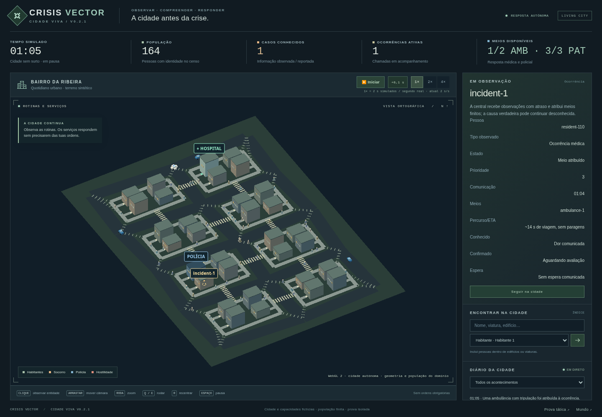

# Living City V0.2.1 — relatório técnico e demonstração

Entrega da [Issue #12](https://github.com/UnnTIL/Crisis-vector/issues/12), no [draft PR #15](https://github.com/UnnTIL/Crisis-vector/pull/15): `feat/living-city-v021-ux` → `feat/urban-living-city-v02`. Base de implementação: `27c99f0addb28011f892bd11e7d9eae36edf7ccb` do PR #11. Foram consultados integralmente a Issue #12, o feedback do PR #11 e `docs/product/LIVING_CITY_ITERATION_V021_V023.md` da branch `docs/product-vision-v1`, revisão `7a65f99`.

## Jogar a versão entregue

[Descarregar o ZIP V0.2.1](https://github.com/UnnTIL/Crisis-vector/raw/refs/heads/feat/living-city-v021-ux/artifacts/living-city-v021/crisis-vector-living-city-v021.zip). Alternativa: [página do ficheiro no GitHub](https://github.com/UnnTIL/Crisis-vector/blob/feat/living-city-v021-ux/artifacts/living-city-v021/crisis-vector-living-city-v021.zip), botão de download.

Extrair o ZIP e executar, na pasta que contém `living-city/`:

```bash
python3 -m http.server 8000
```

No Windows, `py -m http.server 8000`. Abrir `http://127.0.0.1:8000/living-city/` e clicar **Iniciar**. Esta é uma instrução de acesso local; não é uma preview pública.

O ZIP publicado foi realmente descarregado do GitHub com HTTP 200, comparado byte a byte com o original, extraído e executado em Chromium. Foram verificados S0 com admissão hospitalar, S1 com avaliação médica física e S2 com disparos, além de seleção, interface desktop e mobile de 390 px, sem overflow horizontal. O HTML da cidade efetuou um único pedido local e continuou a funcionar após cortar a rede. Evidência: [verificação do pacote](living-city-v021-package-check.json).



O acesso a `unntil.github.io` foi bloqueado pelo proxy deste executor, com rejeição CONNECT HTTP 403; não foi alterada a configuração do ambiente. Por isso a entrega verificável é o ZIP. A execução direta por `file://` também foi bloqueada pela política do Chromium (`ERR_BLOCKED_BY_ADMINISTRATOR`); o servidor estático acima foi testado.

## Alterações de comportamento e arquitetura

### Origem e deteção de ocorrências

- `population.cjs` seleciona uma pessoa existente por PRNG e conserva a sua posição, rotina e percurso. Foram removidos o reposicionamento do paciente e das três testemunhas. A colocação geral de residentes na rua evita nós de estacionamento; não é uma regra especial para o caso inicial.
- `incidents.cjs` substitui os episódios S0 fixos aos 20/240/450 s por revisões dependentes da seed e estado: primeira revisão aos 8–20 s, seguintes a cada 3–10 s, risco ficcional de 13% entre residentes elegíveis, cooldown global de 30–80 s e individual de 180 s, até duas ocorrências médicas ativas. São elegíveis pessoas saudáveis sem outra tarefa de emergência, após caminhada ou rotina em casa/serviço. A perceção tem atraso de 2–7 s; a chamada e o despacho conservam os seus passos próprios. Não há chamada instantânea nem testemunhas criadas para a garantir.
- `initialCaseOrigin`, início efetivo do episódio e primeira observação são registos distintos. O residente pode andar entre a criação do mundo e o início dos sintomas/morte; o relatório não usa a posição inicial como se fosse a posição da ocorrência.

### Câmara e interpolação

Q/E roda 15° em torno do alvo, com 24 passos por volta. Pan, zoom, raycast, seleção, seguimento de pessoas/viaturas/interiores e R continuam funcionais. Atalhos ignoram inputs, seleção, conteúdo editável, modificadores e repetição. R termina o seguimento e repõe a vista inicial.

`presentation/poses.cjs` guarda posições visuais desligadas do estado canónico e interpola entre dois ticks consecutivos de 100 ms. Não lê/escreve regras clínicas nem consome PRNG. Passageiros, modelos, seleção e follow usam a mesma posição desenhada. Embarque, mudança de localização/vida, pausa, reinício e avanço explícito removem poses antigas. A apresentação introduz até um tick de atraso visual; não antecipa decisões ou chegadas.

### Ritmo de jogo

`presentation/time.cjs` declara `BASE_SIMULATION_RATE = 2` e mantém o tick de 100 ms simulados:

| Controlo | Segundos simulados por segundo real | Relação com V0.2 |
| --- | ---: | --- |
| 1× | 2 | Antigo 2× |
| 2× | 4 | Duas vezes a nova referência |
| 4× | 8 | Quatro vezes a nova referência |

O botão **+0,1 s** só atua em pausa e avança exatamente um tick. O acumulador fracionário é preservado. O controlador limita o trabalho por frame e, perante atraso excessivo, pausa explicitamente conservando a fila; não descarta ticks para apresentar mais FPS. A mudança de referência temporal é independente da interpolação e está visível na interface.

### Circulação e continuidade dos serviços

`traffic.cjs` e os helpers fazem cedência a peões no trajeto e em travessia iminente, com espaço de segurança, travagem e aceleração progressiva. Arestas e aproximações finais conservam o ponto físico; não há reposicionamento para facilitar uma recolha. Esperas mútuas permitem desvios, replaneamento ou estacionamento noutro nó rodoviário realmente alcançável, seguido de percurso da tripulação a pé.

As novas origens expuseram problemas antigos de continuidade médica/policial. As correções são limitadas a localização, posse operacional e recuperação de percursos:

- Afiliação em `crewIds`/`officerIds` não concede autoridade para mover um profissional que já é paciente ou passageiro de outro serviço. Embarque, desembarque, contacto e atribuição são exclusivos. Não se recupera uma identidade alterando listas à distância, nem se despacha uma ambulância para o próprio tripulante doente.
- Falhas transitórias de rota são novamente tentadas, com intervalos limitados. Os estados `transportRouteWaiting`/`returnRouteWaiting` preservam o paciente a bordo e não repetem `PatientBoarded`. A aproximação ao hospital exige chegada real à entrada antes da admissão.
- Patrulhas saudáveis conservam a atribuição durante um bloqueio transitório. O retorno a pé também volta a tentar o percurso. Incapacidade real da tripulação continua a retirar o recurso de operação.
- O acesso a uma viatura parada por paciente/tripulação só é permitido no contexto médico atribuído e no ponto físico correto. Não existe uma exceção geral para atravessar viaturas de outros serviços.

Os módulos `health.cjs`, `config.cjs`, `topology.cjs` e `world.cjs` mantêm o conteúdo da base. Tempos de doença, exposição, reanimação, dano, munição e regras de uso da força não foram recalibrados. Os resultados podem mudar porque origem, circulação, acesso e disponibilidade agora evoluem de outra forma. Não se deve interpretar essa diferença como uma calibração epidemiológica.

## Testes automáticos e regressão lógica

`npm test`: **128 testes aprovados**, sem falhas, cancelamentos ou skips, em Node 24.22.1. Inclui os 47 testes anteriores de mundo/dados/spike, 33 testes de integração Living City, 8 de origens, 13 de tráfego, 10 de posse operacional, 12 de apresentação e 5 de tempo. As fixtures antigas que pressupunham um local/instante imposto foram atualizadas para esperar condições reais ou declarar explicitamente o cenário controlado. As invariantes anteriores de pessoas, recursos e serviços mantêm-se.

Regressões específicas cobrem o profissional tratado por outra ambulância, ausência de teletransporte, acesso a meio de aresta, contacto antes de embarcar/admitir, recuperação de rota após embarque e no regresso, deslocação policial e proteção de terceiros. Os testes de tempo comparam 1/10/30/60/144 FPS e multiplicadores 1/2/4, sem perda silenciosa de ticks. Os testes de poses verificam pontos intermédios, passageiros, pausa, transições e ausência de alterações clínicas/PRNG.

A [CI do código `2ff2bcf`](https://github.com/UnnTIL/Crisis-vector/actions/runs/43530786670) aprovou a suite no Node 20. A confirmação da revisão final consta também dos [Checks do PR #15](https://github.com/UnnTIL/Crisis-vector/pull/15/checks).

### Matriz autónoma: 9 execuções de 600 s

[Relatório lógico completo](living-city-v021-report.json), gerado por `scripts/report-living-city-v021.cjs`: S0/S1/S2 × seeds 16927/42/2026, 6 000 ticks por execução, **54 000 verificações por tick** de invariantes estritas e limites de velocidade, sem comandos do jogador. População inicial: 150 residentes + 14 profissionais = 164 identidades.

| Cenário | Seed | Vivos | Mortos | Reanimados ativos | Neutralizados | Admissões | Altas | Ciclos admissão → ambulância disponível | Tiros |
| --- | ---: | ---: | ---: | ---: | ---: | ---: | ---: | ---: | ---: |
| S0 | 16927 | 164 | 0 | 0 | 0 | 5 | 4 | 4 | 0 |
| S0 | 42 | 164 | 0 | 0 | 0 | 4 | 4 | 4 | 0 |
| S0 | 2026 | 164 | 0 | 0 | 0 | 5 | 5 | 5 | 0 |
| S1 | 16927 | 126 | 38 | 8 | 26 | 2 | 0 | 2 | 67 |
| S1 | 42 | 144 | 20 | 0 | 20 | 1 | 0 | 1 | 47 |
| S1 | 2026 | 132 | 32 | 0 | 32 | 2 | 0 | 2 | 80 |
| S2 | 16927 | 163 | 1 | 0 | 1 | 0 | 0 | 0 | 2 |
| S2 | 42 | 163 | 1 | 0 | 1 | 0 | 0 | 0 | 3 |
| S2 | 2026 | 163 | 1 | 0 | 1 | 0 | 0 | 0 | 4 |

Mortos inclui corpos ainda não reanimados, reanimados ativos e neutralizados; não se somam essas colunas à população. Em S0 não ficaram ambulâncias saudáveis permanentemente no estado `blocked`; serviços ainda em curso aos 600 s continuam contabilizados. Verifica-se uma admissão por ocorrência em todos os cenários e um embarque por ocorrência S0; no surto podem existir etapas legítimas adicionais de transporte, pelo que essa segunda condição não é aplicada cegamente a S1/S2.

Cada cenário apresentou três origens físicas diferentes nos três seeds, sem sondagens extra ou posições forçadas:

| Cenário | Seed | Pessoa | Início simulado | Posição real x/z, arredondada | Rotina/local |
| --- | ---: | --- | ---: | --- | --- |
| S0 | 16927 | resident-110 | 55,2 s | 61,928 / 54,452 | Serviço, building-28 |
| S0 | 42 | resident-148 | 11,9 s | 16,422 / 38,700 | Rua, a caminhar |
| S0 | 2026 | resident-004 | 43,8 s | 32,937 / 9,700 | Rua, a caminhar |
| S1 | 16927 | resident-144 | 20,0 s | 56,696 / 15,388 | Casa, building-09 |
| S1 | 42 | resident-009 | 20,0 s | 75,000 / 16,808 | Rua, a caminhar |
| S1 | 2026 | resident-062 | 20,0 s | 78,696 / 15,584 | Casa, building-13 |
| S2 | 16927 | resident-144 | 30,0 s | 56,696 / 15,388 | Casa, building-09 |
| S2 | 42 | resident-009 | 30,0 s | 75,000 / 26,429 | Rua, a caminhar |
| S2 | 2026 | resident-062 | 30,0 s | 78,696 / 15,584 | Casa, building-13 |

Em S1 a tabela usa início dos sintomas; em S2 usa a morte inicial. A diferença de posição de resident-009 aos 20/30 s resulta da caminhada real. Os tempos clínicos dos cenários continuam definidos pela V0.2; a remoção de horários globais aplica-se aos episódios normais S0.

O custo Node de `world.step` teve p50 entre 0,492–1,464 ms, p95 0,908–2,947 ms e p99 1,480–4,573 ms. O heap V8 amostrado ficou entre 19,5–59,4 MiB; as execuções partilham sequencialmente o processo, portanto não são picos isolados por cenário nem memória total/GPU. Estes números não incluem desenho ou áudio.

## Interação no browser

[Evidência funcional](living-city-v021-browser.json), Chromium 156.0.8078.79 / Playwright 1.62.1: **9/9 casos aprovados**, três seeds em cada cenário, distribuídos pelos DPR 1/1,5/2. Cada cenário cobre os três DPR; não é o produto completo de 27 combinações.

Foram exercitados Q/E, edição de campos sem ativar atalhos, pan/zoom após rotação, picking de hospital/pessoa, follow de ocupante oculto e rotação durante follow, R, pausa sem movimento fantasma e passo único. Hashes canónicos confirmam que câmara/apresentação não alteram o motor. As poses de pessoa e viatura foram verificadas nos dois extremos e ponto intermédio, sobre cópias desligadas do estado lógico. Não houve erros JavaScript, pedidos externos ou pedidos falhados; o funcionamento offline após carregamento também passou.

Este verificador controla RAF para tornar as interações reproduzíveis; **não mede FPS**. A API declara exatamente 2/4/8 segundos simulados por segundo real. A janela controlada de 1 000 ms fechou com 19/39/79 ticks completos mais a fração preservada, devido à fronteira do frame; os testes unitários do relógio verificam a contagem exata para intervalos completos.

## Desempenho real de apresentação

As medições seguintes usam RAF e tempo real, separadamente do verificador funcional. Executor Intel Xeon Platinum 8573C, quota de 4 CPUs, Chromium 156, WebGL 2 por **SwiftShader em software**, viewport 1440×900. Seed 16927, uma captura por caso, 2 s de aquecimento + 10 s de captura. As execuções foram sequenciais, sem outras suites/browser concorrentes.

Os intervalos lógicos efetivamente observados constam dos JSON. O aquecimento acontece com a cidade a correr; não é tempo parado. A amostragem de tick e a janela RAF são assíncronas: por exemplo, S1/DPR 1,5 incluiu ticks 515→778 numa captura de 10,023 s, com amostras de estado obtidas por chamadas Playwright separadas antes/depois da janela. O intervalo entre essas chamadas pode incluir trabalho fora da captura; não se atribui a diferença a uma causa específica nem se apresentam todas as janelas como exatamente 20 segundos lógicos, nem se usa esta medição para provar a taxa determinística do relógio.

Evidência bruta: [9 capturas normais](living-city-v021-performance.json), [3 capturas com som](living-city-v021-combat-performance.json), [2 capturas de multiplicadores](living-city-v021-speed-performance.json).

| Cenário / áudio | DPR | Velocidade | FPS | Frame p95 (ms) | Lógica p95 (ms) | Poses p95 (ms) | Render CPU p95 (ms) |
| --- | ---: | ---: | ---: | ---: | ---: | ---: | ---: |
| S0 / desligado | 1 | 1× | 35,37 | 33,40 | 1,60 | 0,30 | 1,60 |
| S0 / desligado | 1,5 | 1× | 28,14 | 50,00 | 1,20 | 0,20 | 1,40 |
| S0 / desligado | 2 | 1× | 18,51 | 66,70 | 1,40 | 0,20 | 1,50 |
| S1 / desligado | 1 | 1× | 36,14 | 33,40 | 2,30 | 0,20 | 1,50 |
| S1 / desligado | 1,5 | 1× | 24,94 | 50,10 | 3,10 | 0,30 | 2,10 |
| S1 / desligado | 2 | 1× | 17,46 | 66,70 | 2,20 | 0,20 | 1,60 |
| S2 / desligado | 1 | 1× | 36,59 | 33,40 | 1,80 | 0,20 | 1,50 |
| S2 / desligado | 1,5 | 1× | 26,12 | 50,00 | 1,50 | 0,40 | 1,80 |
| S2 / desligado | 2 | 1× | 17,15 | 66,70 | 2,90 | 0,30 | 2,20 |
| S2 / ligado | 1 | 1× | 32,59 | 50,00 | 2,40 | 0,20 | 2,00 |
| S2 / ligado | 1,5 | 1× | 26,15 | 50,00 | 1,80 | 0,30 | 1,70 |
| S2 / ligado | 2 | 1× | 17,16 | 66,70 | 2,20 | 0,30 | 2,50 |
| S0 / desligado | 1 | 2× | 34,87 | 33,40 | 1,90 | 0,20 | 1,70 |
| S0 / desligado | 1 | 4× | 32,37 | 50,00 | 1,60 | 0,20 | 1,90 |

Todas as 14 capturas terminaram com a cidade a correr, sem autopausa observada ou erros JavaScript. Nas três capturas S2 com som ligado ocorreram, **durante a captura**, dois tiros lógicos, dois efeitos e dois sons por DPR. O som continua opcional e desligado por defeito.

O custo de renderização acima mede submissão CPU, não tempo GPU. Não há extensão de timer GPU, pelo que o relatório usa `null`; não se interpreta como custo zero. Memória reportada é uma amostra do heap JavaScript, não pico do processo/GPU. Não foram feitos ensaios longos de fugas, repetições para intervalos de confiança ou validação em GPU física. Os resultados **não certificam 60 FPS**, nem estabelecem ganho direto sobre a V0.2, cujas origens e intervalos de trabalho eram diferentes. DPR 2 é particularmente pesado neste executor. As capturas com/sem som não constituem uma comparação causal do custo de áudio, pois não são ensaios pareados repetidos.

## Integridade e reconstrução

Bundle entregue e usado no browser/benchmark: SHA-256 `229b9a89c39b5fc386480fe41bd12de6e4ce6652b8c09b37088bc70780996430`. Os 17 hashes de fontes em [build-info.json](../living-city/build-info.json) foram confrontados com o checkout; os dez hashes do core no relatório lógico correspondem à mesma versão.

ZIP: **405 549 bytes**, SHA-256 `b6f6a19084396291ed759a51e690290974356fc0f6e6d7a3bb15177fffe686e9`. Duas reconstruções independentes produziram ZIPs byte a byte iguais. [Checksums publicados](../artifacts/living-city-v021/SHA256SUMS.txt). A data fixa dos metadados do arquivo serve apenas à reprodutibilidade, não é uma data de recolha factual.

```bash
npm test
node scripts/report-living-city-v021.cjs --output /tmp/living-city-v021-report.json
node scripts/build-living-city.cjs
node scripts/package-living-city.cjs /tmp/living-city-v021-package
node scripts/verify-living-city-v021.cjs --output /tmp/living-city-v021-browser.json
node scripts/check-living-city-package.cjs /tmp/living-city-v021-package/crisis-vector-living-city-v021.zip /tmp/living-city-v021-package-check.json
```

Para reconstruir o bundle é necessário o lockfile existente em `urban-spike/` (`npm ci --prefix urban-spike`); Three.js 0.181.2 e esbuild 0.25.12 mantêm as versões anteriores. Os verificadores de browser usam Playwright e Chromium como ferramentas de desenvolvimento; jogar o ZIP não requer Node, npm ou rede externa. Licenças MIT são incluídas.

Com servidor estático na porta 8000, reproduzir as capturas:

```bash
node scripts/benchmark-living-city.cjs --url http://127.0.0.1:8000/living-city/ --ux-evidence /tmp/living-city-v021-browser.json --output /tmp/v021-performance.json
node scripts/benchmark-living-city.cjs --url http://127.0.0.1:8000/living-city/ --ux-evidence /tmp/living-city-v021-browser.json --output /tmp/v021-combat.json --scenarios S2 --s2-prime-ticks 330 --audio 1
node scripts/benchmark-living-city.cjs --url http://127.0.0.1:8000/living-city/ --ux-evidence /tmp/living-city-v021-browser.json --output /tmp/v021-speed.json --scenarios S0 --dprs 1 --speeds 2,4
```

## Limitações e âmbito preservado

- Em S1/2026, police-car-1 permaneceu com rota pendente entre 237,6–329,8 s: **92,3 s simulados** sem caminho seguro, com um profissional reanimado como último obstáculo observado. Retomou a marcha aos 329,9 s. Não houve bloqueio permanente observado nos 600 s dos três seeds; isto não prova ausência de impasses em todos os mundos possíveis. Obstáculos permanentes ou tripulações incapacitadas podem impedir uma resposta legítima.
- O tráfego é um modelo simples de proximidade/cedência/replaneamento, sem física completa, semáforos ou vias detalhadas. Tempos de espera e equilíbrio de ocorrências precisam de revisão humana na demo.
- Campos históricos de espera podem sobreviver a deslocação ou neutralização. O relatório identifica-os como `pedestriansWithRetainedWaitMetadata` e inclui vida, atividade e rota; não os conta automaticamente como pessoas vivas em fila. A UI de viaturas apresenta o estado atual de circulação.
- A doença progressiva continua severa e dependente da seed. Interiores, hospital como compartimento único, exposição sem decaimento e ausência de fuga civil geral continuam com as aproximações V0.2. São matéria posterior, não correções introduzidas aqui.
- Não foram implementados Laboratório V0.2.2, presets/importação/exportação na UI, sincronização GitHub, zonas interiores/infeção V0.2.3, economia, safe zones ou campanha mundial. O relatório CLI é evidência de desenvolvimento, não um laboratório no produto.
- Mundo nacional, baseline factual, `/urban-spike/`, documentos e artefactos V0.2 mantêm o conteúdo da branch base. Os artefactos novos usam caminhos V0.2.1 separados. Não houve merge nem publicação Pages.
