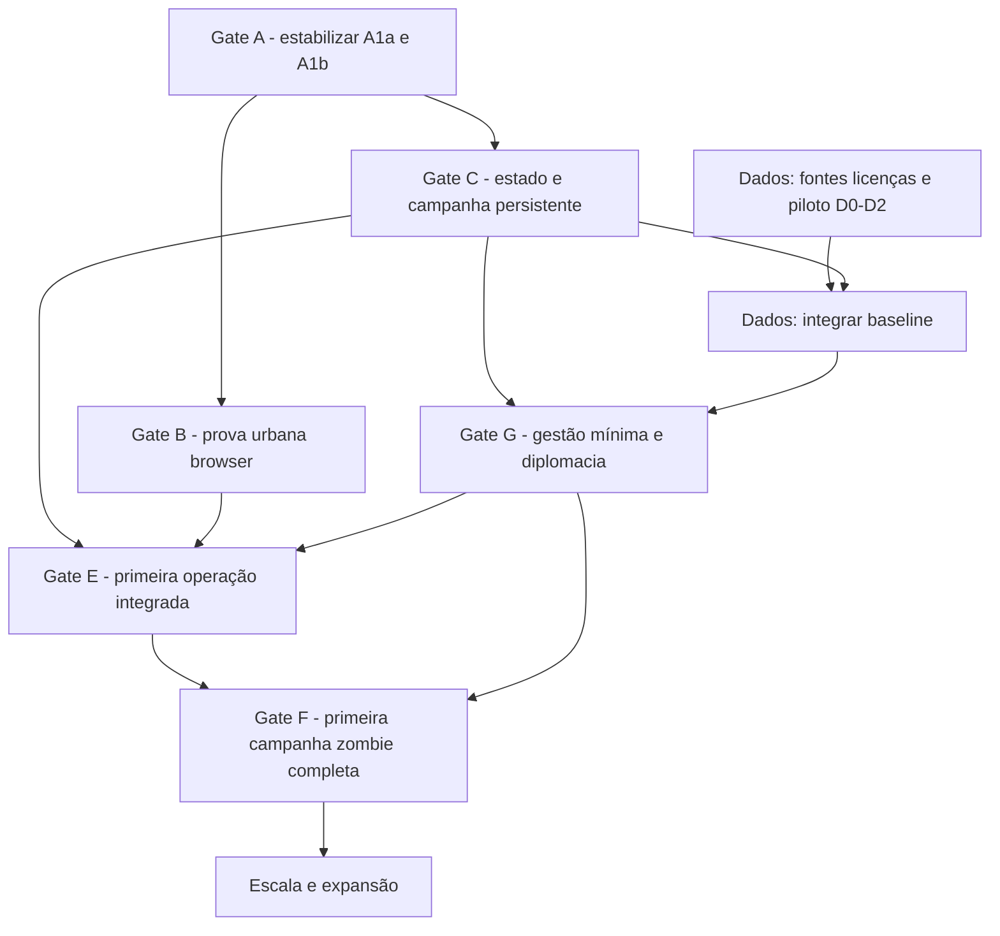

# CRISIS VECTOR — Roadmap integrado de produto e engenharia (v2)

**Estado:** `PROPOSED` quanto à sequência fina e estimativas; direções de produto aprovadas identificadas no [Decision Log](DECISION_LOG.md).  
**Atualização:** 2026-11-12. **Horizonte:** milestones e *gates* de qualidade, **sem datas ou promessas de entrega**.  
**Documentos:** [BASELINE DATA V1](BASELINE_DATA_V1.md) · [POLICY SIMULATOR](POLICY_SIMULATOR.md) · [DEVELOPMENT ROADMAP anterior](DEVELOPMENT_ROADMAP.md) · [TECHNOLOGY ASSESSMENT](TECHNOLOGY_ASSESSMENT.md).

## 1. Norte de produto

Campanha com um país fixo, num mundo persistente e autónomo, que evolui de prevenção para crise e recuperação. O jogador controla um governo e pode aprofundar a gestão fiscal, dívida, saúde, defesa, ciência, educação, diplomacia e operações urbanas. Primeiro cenário completo: crise zombie, com representação urbana 2.5D/3D simples, hordas agregadas e ordens por zonas/equipas.

Um motor canónico, dados iniciais versionados, regras comuns para jogador/IA e resultados causais. As três vistas são representações do mesmo estado. O browser é candidato inicial, sujeito a benchmark; possibilidade futura de distribuição desktop.

## 2. Situação real do projeto (2026-11-12)

| Item | Situação verificada ou conhecida |
| --- | --- |
| Alpha 0.1 / `main` | Demo browser existente e testável, **não** simulador geopolítico completo |
| [PR #1](https://github.com/UnnTIL/Crisis-vector/pull/1) | Documentação produto/arquitetura em draft, **ainda sem merge** |
| [PR #5](https://github.com/UnnTIL/Crisis-vector/pull/5) | A1a — código financeiro e comandos em draft; testes reportados/CI já verificados na revisão, **sem merge** |
| [Issue #3](https://github.com/UnnTIL/Crisis-vector/issues/3) | A1b — conservação populacional, **por implementar** |
| [Issue #4](https://github.com/UnnTIL/Crisis-vector/issues/4) | B — prova urbana, **por implementar** |
| [Issue #6](https://github.com/UnnTIL/Crisis-vector/issues/6) | Sistema híbrido de políticas, **concebido parcialmente, sem código** |
| [Issue #7](https://github.com/UnnTIL/Crisis-vector/issues/7) | Baseline real, **especificada, sem pipeline nem dados recolhidos** |

O documento não afirma que protótipos ou baselines já estejam executados.

## 3. Caminho crítico e frentes paralelas

A documentação, investigação de dados e preparação do benchmark podem avançar em paralelo. A prova B só precisa dos contratos mínimos A, **não** da diplomacia completa ou dados urbanos reais. A primeira integração de operações E requer relógio/persistência, capacidade operacional mínima e prova visual útil.

## 4. Milestones e critérios de saída

### G0 — Alinhar documentação e disciplina de PR

**Objetivo:** PR #1 consolida visão/decisões e especificações sem alegar implementação. Fixar o estado de cada decisão e a fonte única de verdade.  
**Gate:** documentos sem contradições materiais, links internos e decisões classificadas. Merge documental após revisão humana, sem misturar commits de código.

### A1a — Estabilização do financiamento e dos comandos

**Objetivo:** terminar [PR #5](https://github.com/UnnTIL/Crisis-vector/pull/5), validar inputs, custos partilhados IA/jogador, obrigações e degradação com testes.  
**Risco:** prioridade de pagamento fixa e custos iguais em economias diferentes podem produzir incentivo/assimetria pouco realista. **Ainda não existe simulador fiscal nem prioridades editáveis.**  
**Gate:** testes/CI, revisão de equilíbrio Portugal + país de menor rendimento em 60/120 dias, consequências do subfinanciamento explicadas. Não acrescentar o simulador híbrido neste PR.

### A1b — População, ameaça e transferência conservada

**Objetivo:** reparar evacuação abstrata, definir origem/trânsito/destino, coortes com estados e consequência de transformação zombie.  
**Gate:** conservação exata, nenhum duplo embarque/óbito, resultados idempotentes, cenários de capacidade insuficiente, determinismo. Sem logística mundial completa.

### A1c — Qualidade de UI e regressões

**Objetivo:** corrigir defeitos HiDPI de seleção do mapa e seleção de unidades após reinício, com testes de browser.  
**Gate:** DPR 1/1,5/2 e reinício corretos; não bloquear A1b/B por estética não crítica, mas não transportar defeitos conhecidos para a nova interface.

### B — Prova urbana de jogabilidade e desempenho (paralela à preparação de C)

**Objetivo:** uma pequena cidade sintética original, câmara ortográfica, edifícios simples, hordas agregadas, equipas com ordens, barreira e corredor de evacuação. A posição/rota tem efeitos reais.  
**Candidata:** Three.js/WebGL 2 no browser, mundo em Canvas 2D.  
**Gate:** medir carga visual vs lógica, p50/p95/p99, CPU/GPU/memória, picking, determinismo e desempenho em hardware de referência; decidir manter Web ou reavaliar tecnologia. **Não** transformar B numa segunda campanha.

### D0–D2 — BASELINE DATA V1 (em paralelo)

**Objetivo:** selecionar fontes e licenças, importar cinco países-piloto (PRT, DEU, USA, BRA, MWI), normalizar, congelar séries e identificar ausências.  
**Gate:** metadados por série, licenças verificadas, hash reproduzível, cobertura/qualidade pública no repositório, teste de cinco países. **Não** substituir os dados da Alpha antes de D3.

### C — Campanha persistente e relógio canónico

**Objetivo:** configuração de cenário, país fixo, tempo único, comandos/eventos, guardar/carregar, objetivos e métricas; IA básica sob mesmas regras.  
**Gate:** guardar durante operações/escassez, reabrir sem duplicações, replay com seed/versão de dados, UI independente de FPS, condições de vitória provisórias e arranque offline validado.

### D3 — Integração inicial de dados reais na campanha

**Objetivo:** gerar estado inicial a partir de dados congelados + parâmetros sintéticos identificados, usando contratos de C.  
**Gate:** dados observados não são sobrescritos por balanceamento, jogos reproduzíveis e países com perfis explicáveis; falhas de cobertura não geram números falsos.

### G1 — Governação híbrida mínima e diplomacia básica

**Objetivo:** primeiro ciclo jogável de impostos, tesouraria, prioridades por país, despesas e uma alternativa de financiamento; diferenças nacionais, comandos delegados; uma negociação/entrega de ajuda bilateral com capacidades finitas.  
**Recorte:** não começar com bancos completos, todos os ministérios, mercados complexos ou política monetária universal.  
**Gate:** uma estratégia de prevenção versus resposta produz efeitos observáveis; IA paga os mesmos custos; dívida cria passivo e serviço, e não uma fonte infinita; prioridades editáveis e delegação não criam estados diferentes.

### G2 — Capacidades nacionais e políticas de preparação

**Objetivo:** duas políticas inicialmente profundas (ex.: vigilância sanitária e reservistas), com formação, mobilização, investigação e dependências materiais/financeiras. Expandir educação, ciência, indústria, proteção civil e logística de forma incremental.  
**Gate:** custo de oportunidade real; medidas executadas ao longo do tempo; países menos dotados conservam alternativas viáveis por preparação/cooperação.

### E — Primeira operação urbana integrada

**Objetivo:** uma cidade operacional ligada ao país: unidades destacadas deixam de estar disponíveis na reserva, população desloca-se, despesas e perdas são únicas, diplomacia pode fornecer ajuda.  
**Gate:** posição/perímetro mudam resultados; abrir/fechar cidade não afeta lógica; operação prossegue fora de ecrã; resultado reconcilia o mundo.

### F — Campanha zombie vertical completa (Portugal e outro perfil nacional)

**Objetivo:** ciclo prevenção → detecção → escalada condicional → contenção/evacuação → estabilização/recuperação, com IA internacional e governo híbrido mínimo.  
**Gate:** objetivos verificáveis, pontuação contextual, 30–60 dias de jogo como ensaio inicial (não horizonte final), saves/replay, pelo menos duas estratégias viáveis, equilíbrio e desempenho documentados.

### X — Expansão após vertical slice validado

Mais regiões e cidades reais, logística e diplomacia profundas, instituições internacionais, investigação avançada, interface acessível/idiomas, distribuição PC, novos cenários (pandemia/alienígena) **após** validar reutilização real dos contratos. Dados adicionais exigem proveniência e licença.

## 5. O que não fazer agora

- Importar todos os indicadores para 177 países antes de testar cinco.
- Transformar PIB, orçamento e despesa militar numa escala única de poder.
- Reescrever para motor nativo sem evidência de benchmark.
- Introduzir 3D como autoridade de população/combate separada do motor.
- Introduzir o simulador fiscal/dívida no PR A1a em revisão.
- Fazer merge automático de PRs draft ou fingir que documentação equivale a implementação.
- Criar dezenas de políticas sem validar duas escolhas estratégicas concretas.

## 6. Ordem de execução imediata sugerida

1. **Resolver PR #5 / A1a:** revisão de sustentabilidade/efeitos e CI; decidir merge apenas após correções necessárias.
2. **Consolidar PR #1:** atualizar documentos ROUND-001/ROUND-002 e aprovar a arquitetura de produto; merge documental separado.
3. **Autorizar piloto D0–D2 da Issue #7** em branch isolada, sem tocar no motor, em paralelo com a preparação de benchmark B.
4. **Implementar A1b e preparar B** com contratos mínimos de população/tempo, e executar prova WebGL.
5. **Avançar para C + D3 + G1:** campanhas persistentes, baseline real integrada, governação fiscal/diplomacia mínimas.
6. **Construir E e F:** operação integrada e primeira campanha completa.

## 7. Próximo marco verificável

A próxima prova que altera a decisão de produto deve responder: **(a)** o browser suporta uma cidade legível e interativa com hordas sem comprometer a simulação? **(b)** os dados iniciais de cinco países e o modelo económico criam opções estratégicas diferenciadas e justas? **(c)** as operações urbanas e a política nacional continuam a partilhar recursos num único estado?

O projeto não deve progredir pelo número de ficheiros ou mecânicas adicionados, mas por ciclos completos de decisão → execução → consequência → explicação.
