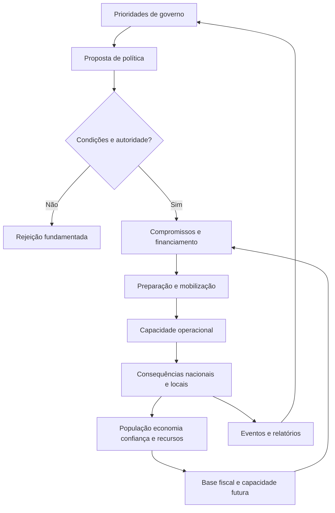

# CRISIS VECTOR — Simulador híbrido de governação e políticas nacionais

**Estado:** `PROPOSED` quanto às regras quantitativas e arquitetura; **direção funcional aprovada** quanto ao controlo híbrido, fiscalidade simplificada, dívida, prioridades editáveis e políticas de Estado.  
**Data:** 2026-11-12. **Origem:** direção criativa, [Issue #6](https://github.com/UnnTIL/Crisis-vector/issues/6) e [PR #1](https://github.com/UnnTIL/Crisis-vector/pull/1).  
**Âmbito:** conceção e contratos funcionais, **sem implementação**. Complementa [GEOPOLITICS_AND_ECONOMY](GEOPOLITICS_AND_ECONOMY.md), não substitui a Alpha A1a do [PR #5](https://github.com/UnnTIL/Crisis-vector/pull/5).

## 1. Princípio de produto — simples de operar, profundo nas consequências

O jogador dirige um país escolhido no início da campanha. Define prioridades nacionais, políticas e medidas com impactos na população, na economia, nas capacidades e na diplomacia. O mesmo estado de jogo deve servir:

- **Modo estratégico:** escolher uma orientação (prevenção, resiliência, investigação, defesa, austeridade, recuperação), ajustar grandes dotações e delegar a execução ao governo simulado.
- **Modo detalhado:** abrir um setor e alterar parâmetros concretos, contratos, ações, prioridades de pagamento e calendários.
- **Execução delegada:** ministros/agências executam ações permitidas pela estratégia, orçamento, obrigações e regras; podem apresentar propostas e pedidos de decisão.
- **Regra central:** não existem dois motores. O modo detalhado não cria recursos e o automático não ganha eficácia gratuita. A diferença é o nível de intervenção.

Uma estratégia é uma intenção, não uma garantia. A política precisa de autoridade, financiamento, pessoas, materiais, tempo, capacidade de execução e informação disponível. O efeito pode surgir gradualmente, chegar tarde ou produzir consequências inesperadas mas explicáveis.

## 2. Fluxo sistémico fundamental



O motor deve distinguir **ação anunciada**, **medida aprovada**, **medida financiada**, **preparação**, **implementação**, **resultado** e **eventual suspensão**. Cancelar uma medida não apaga custos já incorridos ou compromissos.

## 3. Receita pública: fiscalidade simplificada mas causal

Criar inicialmente três bases fiscais agregadas, claramente diferentes do PIB:

| Base | Instrumento do jogador | Resultado esperado e limitações |
| --- | --- | --- |
| Rendimentos do trabalho | Taxa média efetiva de imposto sobre rendimento | Receita, rendimento disponível, incentivos e aceitação social; depende da massa salarial tributável e cumprimento |
| Consumo | Taxa média efetiva de imposto sobre consumo | Receita e preços ao consumidor, com possível redução da base de consumo |
| Resultados das empresas | Taxa média efetiva sobre lucros | Receita e capacidade de investimento privado; depende de lucros tributáveis |
| Contribuições sociais | Candidato para fase posterior | Pode financiar proteção social e ter impactos no custo do trabalho |

**Não** calcular receita como `taxa × PIB` indiscriminadamente. Usar uma base agregada por categoria, obtida de condições iniciais/indicadores económicos, emprego, produção, consumo, cumprimento fiscal e políticas. A receita chega em períodos de liquidação, não instantaneamente ao alterar uma taxa.

Não criar uma simulação de todas as famílias e empresas. Utilizar coortes económicas quando uma mecânica exigir diferenças entre rendimentos ou exposição à crise.

O jogador poderá: ajustar a combinação fiscal, aprovar sobretaxas temporárias, criar incentivos/reduções de impostos e melhorar capacidade de cobrança (com custos e demora). Alterações agressivas poderão aumentar a receita inicial mas reduzir atividade, apoio político ou cumprimento. Todas as curvas são **parâmetros de jogo propostos**, dependentes de testes; não afirmar elasticidades económicas exatas.

## 4. Tesouraria, orçamento, compromissos e financiamento

Separar rigorosamente:

1. **Receita corrente:** impostos e outras entradas não reembolsáveis (origem identificada).
2. **Tesouraria e reservas financeiras:** dinheiro disponível; não é PIB nem capacidade industrial.
3. **Despesas de funcionamento:** obrigações existentes e custos recorrentes.
4. **Dotações discricionárias:** envelope realmente disponível para redistribuir após obrigações e reservas mínimas.
5. **Investimento de longo prazo:** projetos pluriperíodo, com fases e capacidade de execução.
6. **Dívida e atrasados:** passivos distintos, com serviço e vencimentos.
7. **Recursos materiais e humanos:** stocks e capacidades separados do dinheiro; não podem ser comprados instantaneamente se não houver oferta/logística.

### 4.1. Prioridades editáveis

Distinguir **alocação estratégica de orçamento** de **ordem de pagamento quando a tesouraria não chega**:

- O jogador pode escolher dotações setoriais e uma estratégia de proteção (p.ex. saúde, abastecimento, defesa, investigação).
- As despesas já contratadas mantêm-se até cessação/revogação válida, com custos de saída e atrasados quando incumpridas.
- Quando ocorre escassez, definir prioridades nacionais que podem ser alteradas; a IA utiliza as mesmas regras, mas com as suas próprias preferências e informação.
- Uma mudança de prioridade não deve teletransportar dinheiro/viaturas, apagar contratos ou recuperar pessoal em horas.

O A1a atual contém `FINANCE_RULES.priority` fixa (`emergency → units → mobilized → borders`). **É um mecanismo transitório de reconciliação financeira, não a decisão de produto final.** A edição de prioridades por país é uma capacidade futura e deve constar explicitamente do backlog.

### 4.2. Emissão de dívida pública

A dívida não é receita fiscal. Propor uma ação `issueGovernmentBonds` com montante-alvo, prazo, taxa/cupão ou mecanismo de formação de taxa, calendário e moeda; confirmar a colocação efetiva antes de creditar tesouraria.

A procura potencial é limitada por poupança/liquidez disponível e confiança: **famílias (aforradores), intermediários financeiros e investidores institucionais domésticos/estrangeiros** representam grupos agregados, não compradores infinitos. Ao subscrever, transferem recursos financeiros existentes ao Estado e recebem um crédito; futuros juros/repagamentos saem da tesouraria. Compras domésticas podem reduzir outras aplicações e consumo; juros domésticos são redistribuição entre setores, não desaparecimento do mundo.

Oferta não colocada não financia despesa. Dívida externa também depende de risco, acesso ao mercado, moeda e relações. Incumprimento gera consequências em confiança, juros futuros e estabilidade; refinanciamento não é ilimitado.

**Soberania monetária:** países de união monetária, como Portugal na zona euro, não controlam individualmente a emissão da moeda ou a taxa diretora da união. O cenário deve distinguir emitir dívida em moeda existente de criar moeda. Não introduzir política monetária nacional onde o Estado não tem essa competência.

### 4.3. Insuficiência financeira

Não existe derrota automática no saldo zero. Aplicar proteção/ordem de pagamento escolhida, reservas disponíveis, eventual financiamento efetivo, atrasados e deterioração gradual por serviço. O jogador pode renegociar, suspender, reduzir ou repriorizar, suportando penalizações causais.

O modelo pode usar um orçamento de previsão para 7/30/90 dias (proposta de UI) e apresentar margem/risco; não deve cobrar diariamente impostos anuais sem conversão temporal explícita.

## 5. Políticas de Estado — famílias e causalidade

| Família | Políticas possíveis (a introduzir por fases) | Dependências e efeitos |
| --- | --- | --- |
| Saúde e proteção civil | Vigilância, reforço hospitalar, equipas de emergência, formação, evacuação | Médicos, instalações, transporte, consumíveis, atraso; prevenção, sobrevivência e confiança |
| Defesa e segurança | Serviço militar obrigatório (quando admissível), voluntariado, forças de reserva, treino, mobilização, aquisições | Recrutáveis, legislação/apoio, tempo de instrução, equipamentos, abastecimento, fadiga; retira trabalhadores de outros setores |
| Educação e formação | Ensino e formação profissional, programas técnicos, especialização | Despesa recorrente e capacidade escolar; efeitos predominantemente de médio/longo prazo |
| Ciência e tecnologia | Laboratórios, investigação epidemiológica, novos métodos de contenção, tecnologia | Investigadores, instalações, financiamento continuado, cooperação; avanço incerto e gradual |
| Economia e indústria | Incentivos, produção essencial, conversão industrial, proteção do emprego | Matérias-primas, energia, pessoal, importações, tempo; altera bases fiscais e oferta |
| Logística e infraestruturas | Reservas estratégicas, energia, transportes, manutenção e corredores | Stocks, instalações, acesso, mão de obra; condiciona intervenções locais |
| Governação e comunicação | Informação pública, legislação, emergência, coordenação administrativa | Autoridade legal, confiança, legitimidade, cumprimento; custos e possíveis resistências |
| Diplomacia | Acordos, ajuda, partilha científica e financiamento externo | Relações, capacidade do parceiro, condições e tempos; compromissos bilaterais |

**Sem mecanismos de poder instantâneo:** obrigatoriedade militar não cria soldados treinados ao decretar a medida; reservas exigem formação, disponibilidade e equipamento. Educação não gera cientistas num dia. Investigação não tem vitória automática por temporizador.

A viabilidade legal/institucional de certas medidas difere por país e cenário. Para a primeira versão, usar regras de elegibilidade simplificadas e documentadas, sem atribuir competências inexistentes a governos.

## 6. Horizonte da campanha

Diferenciar períodos sem alterar arbitrariamente o tempo: **prevenção/preparação** (efeitos de meses/anos ou capacidade pré-existente no cenário), **escalada** (dias/semanas), **resposta** (horas/dias), **recuperação** (semanas/meses). Todas as operações seguem um único relógio canónico.

A primeira campanha poderá começar com condições históricas e capacidades preparadas, permitindo ao jogador escolher investimentos com períodos de impacto úteis. Não acelerar uma reforma de educação para efeito imediato só por conveniência.

## 7. Contrato de política proposto (não definitivo)

Uma política ou programa deve poder declarar:

```text
policyId, countryId, sectorId, status, authorityRequirements,
fundingSource, upfrontCost, recurringCost, materialRequirements,
personnelRequirements, implementationLeadTime, capacityRamp,
targetRegionIds, eligibility, observability, legitimacyEffects,
economicEffects, operationalEffects, cancellationConsequences,
eventIds, ruleVersion
```

Ações de jogador ou IA: `proposePolicy`, `approvePolicy`, `setFundingPriority`, `setSectorAllocation`, `changeTaxPolicy`, `issueGovernmentBonds`, `pausePolicy`, `cancelPolicy`. **São nomes conceptuais, não APIs implementadas.** Cada ação deve ser validada e registada com causas e efeitos; a mesma operação repetida não duplica resultados.

Indicadores económicos agregados e governação alimentam o mesmo mundo canónico que opera cidades, unidades, deslocações e diplomacia. Não existe dinheiro ou população especial na interface detalhada.

## 8. Jogabilidade, informação e equilíbrio

- A interface distingue situação atual, consequências previstas (estimativas com incerteza), compromissos futuros e resultados ocorridos.
- Cada medida apresenta custo de ativação, manutenção, prazo de preparação, requisitos, benefício esperado, risco social e alternativas.
- A IA precisa de executar políticas autonomamente dentro de objetivos nacionais e prioridades, sob restrições equivalentes às do jogador.
- Países pouco ricos devem ter estratégias viáveis por prevenção, foco setorial, reservas, diplomacia e eficiência; não receber bónus arbitrários sem origem para parecer equilibrado.
- A população afeta receita, legitimidade, cumprimento, trabalho disponível e subscrição de dívida; não é um recurso passivo ou infinito.
- Sem recompensa por aumentar um imposto e revertê-lo repetidamente, emitir dívida circular ou abrir/fechar a mesma política.

## 9. Primeiro recorte recomendável de implementação (futuro, não autorizado)

1. Uma tesouraria canónica por país e envelope discricionário; ordens de prioridade por país (sem alterar as invariantes A1a).
2. Três bases fiscais agregadas e uma única política fiscal com efeito temporal e feedback económico.
3. Um título de dívida simples com procura finita, juros e vencimento, teste de liquidez e passivo.
4. Duas políticas úteis à crise (p.ex. preparar reservistas e reforçar vigilância), com capacidade e tempo, criando alternativas estratégicas.
5. Modo estratégico/delegação e painel detalhado apontam aos **mesmos comandos**.
6. Testar Portugal e um Estado economicamente mais frágil: receitas, compromissos, prestação de serviços, confiança, prevenção, dívida e custo de oportunidade. Introduzir dados externos apenas quando necessários e documentados.

**Não** adicionar estes mecanismos ao PR A1a já em revisão. A A1a trata correção contabilística inicial; este simulador será um novo incremento depois das decisões e prioridades relevantes.

## 10. Questões técnicas que permanecem propostas

- Quanto do orçamento pode ser redistribuído livremente, e que obrigações são não discricionárias?
- Como mostrar modo simples/avançado e respeitar escolhas manuais face à delegação?
- Qual a elasticidade e atraso das bases fiscais, e qual o impacto de alterações de taxas?
- Como modelar dívida pública interna/externa sem simular bancos individuais?
- Qual o tempo de preparação útil da primeira campanha e a profundidade de educação/investigação?
- Quais os limites institucionais por país e as condições de colapso político?

Nenhuma taxa, escala, proporção de orçamento ou tempo está aprovada por este documento. Validar por protótipos de decisão e por simulações com seeds fixas antes de considerar a economia equilibrada.
