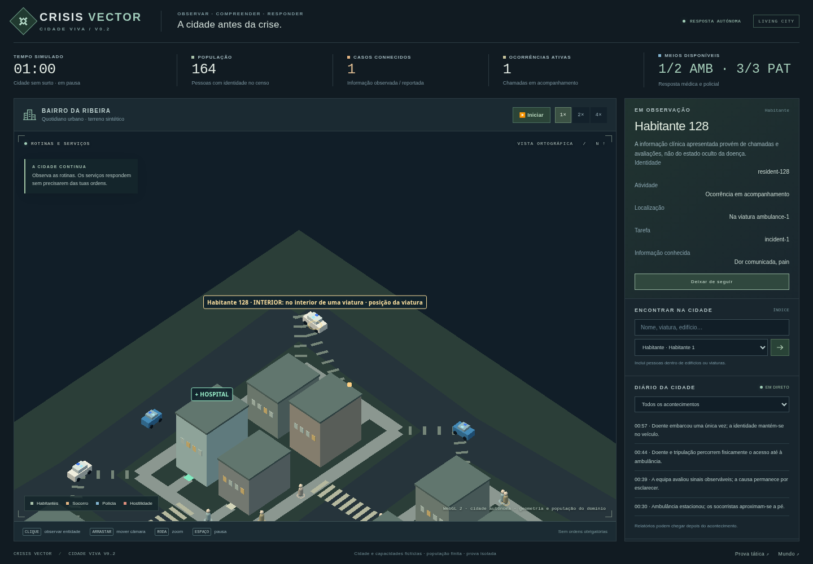

# CRISIS VECTOR — Urban Living City V0.2

Cidade pequena, autónoma e fictícia, desenvolvida a partir do [PR #9](https://github.com/UnnTIL/Crisis-vector/pull/9), conforme a [Issue #10](https://github.com/UnnTIL/Crisis-vector/issues/10). O [draft PR #11](https://github.com/UnnTIL/Crisis-vector/pull/11) tem como destino `spike/urban-webgl`. A Alpha mundial, a baseline e a prova tática anterior continuam disponíveis; não há integração da campanha, A1b, economia ou safe zones estratégicas.

## Experimentar

[ZIP autónomo no GitHub](https://github.com/UnnTIL/Crisis-vector/raw/refs/heads/feat/urban-living-city-v02/artifacts/living-city-v02/crisis-vector-living-city-v02.zip) · [SHA-256](../artifacts/living-city-v02/SHA256SUMS.txt)

Extrair o ZIP e, na pasta que contém `living-city/`, executar:

```bash
python3 -m http.server 8000
```

No Windows: `py -m http.server 8000`. Abrir `http://127.0.0.1:8000/living-city/`. Com o checkout, o mesmo servidor funciona na raiz sem instalação de dependências: o bundle já contém Three.js, código e estilos locais. O ZIP inclui um HTML urbano autónomo e também as demos anteriores. A execução por servidor estático é a via de teste; a política do Chromium gerido bloqueia abertura direta por `file://`.

A cidade inicia em S0 e funciona sem ordens. Mudar cenário ou reiniciar coloca a simulação em pausa; usar **Iniciar** para continuar. Escolher entre:

- **S0 — Cidade sem surto:** rotinas e chamadas médicas normais. A ameaça não é criada por calendário.
- **S1 — Doença progressiva:** um habitante existente adoece; a resposta médica pode anteceder a descoberta da ameaça. A patologia desconhecida não é curada automaticamente pelo hospital.
- **S2 — Transformação súbita:** um habitante existente morre e reanima rapidamente; testemunhas e patrulhas desencadeiam a resposta.

Selecionar no mapa ou pesquisar na lista. **Seguir** acompanha uma pessoa, viatura, instalação ou ocorrência. Uma pessoa no interior continua no censo; o marcador de seguimento identifica o edifício, sem inventar movimento na rua. Para observar o ciclo médico, escolher S0, acompanhar a primeira ocorrência no diário e selecionar a ambulância atribuída. S1/S2 mostram diferentes escaladas, com recursos finitos.

Controlos: clique seleciona; arrastar move a câmara; roda amplia; Espaço pausa; `R` recentra e termina o seguimento; velocidades 1×/2×/4×. O som começa desligado e só é ativado por clique explícito. Volume, mute e redução de flashes não alteram a lógica. O modo **debug** revela informação oculta e está assinalado no ecrã.



## O que observar

O bairro tem oito quarteirões e 32 edifícios, redes pedonal/viária distintas e entradas ligadas a casas, comércio, trabalho, hospital e esquadra. Por defeito existem 150 residentes, quatro socorristas, seis agentes policiais e quatro profissionais hospitalares: **164 identidades**. Duas ambulâncias e três patrulhas usam pessoas e viaturas distintas.

O ciclo é `observação → chamada → central/triagem → despacho → deslocação → avaliação → intervenção → consequência`. Chamadas têm atraso, prioridades e espera; ambulâncias percorrem as estradas e as pessoas percorrem os acessos a pé. Hospitalização, transporte, doença, morte, reanimação e neutralização conservam as mesmas identidades.

A polícia patrulha e responde autonomamente. Disparar exige ameaça hostil observada, alcance, linha de visão, munições e corredor de tiro seguro, incluindo durante aproximação. Um infetado não hostil não é alvo pelo diagnóstico. Não há reposição gratuita de agentes, veículos ou munições.

A interface apresenta observações e avaliações conhecidas; saúde verdadeira só em debug. Novas chamadas entram no índice após receção ou confirmação profissional. Os eventos verdadeiros, reportados e confirmados são distinguidos no domínio. O motor e o seu RNG não dependem da câmara, som ou frequência de desenho.

## Etapas e validação

- **LC-0:** topologia, população finita, rotinas, localizações e contratos.
- **LC-1:** ocorrências normais, despacho, ambulância, recolha e hospital.
- **LC-2:** doença, exposição por duração/distância e transformação da mesma pessoa.
- **LC-3:** agentes policiais, patrulhas, reconhecimento, intervenção e retirada.
- **LC-4:** observação, seleção/seguimento, efeitos de eventos, áudio e medições.

Consultar [regras e limites reais da implementação](../docs/LIVING_CITY_RULES.md), [matriz de aceitação](../docs/LIVING_CITY_ACCEPTANCE.md) e [relatório de execução](../docs/LIVING_CITY_VALIDATION.md). As amostras e resultados são guardados separadamente; os números da V0.1 não são apresentados como medições da V0.2.

```bash
npm test
node scripts/report-living-city.cjs --output /tmp/living-city-report.json
```

Os testes incluem fixtures de chamadas concorrentes, hospital lotado, via interrompida, viatura avariada e polícia ocupada. A matriz usa seeds 16927/42/2026 × S0/S1/S2 por 600 segundos simulados, sem ordens, com invariantes a cada tick.

## Construir e empacotar

```bash
npm ci --prefix urban-spike
node scripts/build-living-city.cjs
node scripts/package-living-city.cjs /tmp/living-city-package
```

O build reutiliza Three.js **0.181.2** e esbuild **0.25.12**, fixados no lockfile do protótipo. Não é necessário reinstalá-los se já estiverem disponíveis. A licença MIT de Three.js é preservada. `build-info.json` identifica fontes e bundle por SHA-256. O pacote usa ordem e metadados fixos para permitir reconstrução byte a byte.

O teste de browser requer Playwright **1.62.1** e Chromium; são ferramentas de desenvolvimento, não dependências da partida. O executor já os fornece. Noutro ambiente, instalar separadamente Playwright e um Chromium compatível, ajustando o executável no script se necessário.

```bash
node scripts/benchmark-living-city.cjs \
  --url http://127.0.0.1:8000/living-city/ \
  --output /tmp/living-city-browser.json --warmup-ms 2000 --capture-ms 10000
```

Para o primeiro confronto S2 com áudio e efeitos ativos:

```bash
node scripts/benchmark-living-city.cjs --url http://127.0.0.1:8000/living-city/ \
  --output /tmp/living-city-combat.json --scenarios S2 --s2-prime-ticks 470 --audio 1
```

Para verificar um ZIP, com as mesmas ferramentas de browser:

```bash
node scripts/check-living-city-package.cjs /tmp/living-city-package/crisis-vector-living-city-v02.zip /tmp/living-city-package-check.json
```

O benchmark curto cloud não certifica 60 FPS em GPU física. O relatório identifica browser, GPU observada, DPR, populações lógicas/visíveis, tempos de frame/lógica/submissão, memória e omissões.

## Limites

Não existem interiores detalhados, tráfego civil completo, geografia real, epidemiologia clínica, capacidades militares factuais ou campanha persistente. Contactos e letalidade são regras ficcionais calibráveis. O hospital trata as ocorrências normais da fixture; não descobre uma cura para o agente patogénico. A crise pode sobrecarregar os serviços finitos.

A preview online só será apresentada como funcional após teste real do URL. O domínio GitHub Pages continua bloqueado pela política de rede deste executor; o pacote obtido do GitHub e executado localmente é a alternativa verificável. Não é necessário alterar as configurações do ambiente para jogar com o ZIP.
