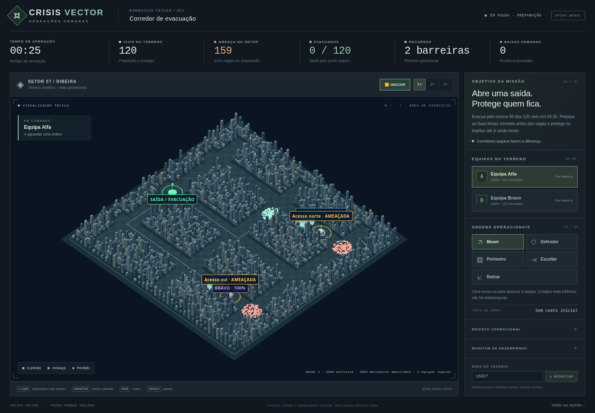

# CRISIS VECTOR — primeira operação urbana WebGL

Prova **isolada, original e jogável**, baseada na [Issue #4](https://github.com/UnnTIL/Crisis-vector/issues/4). Parte da `main` após integração da baseline factual, sem incorporar o PR #5, implementar A1b ou consumir dados reais. Nenhum ficheiro do motor/UI mundial foi substituído.

## Jogar

[Descarregar o ZIP autónomo](https://github.com/UnnTIL/Crisis-vector/raw/refs/heads/spike/urban-webgl/artifacts/urban-spike/crisis-vector-urban-spike.zip) · [SHA-256](../artifacts/urban-spike/SHA256SUMS.txt)



Com o ZIP publicado, extrair e abrir `urban-spike/index.html` num browser desktop com WebGL 2. Esse HTML contém código, estilos e Three.js locais. Se o browser restringir `file://`, executar na pasta extraída:

```bash
python3 -m http.server 8000
```

Abrir `http://127.0.0.1:8000/urban-spike/`. O `index.html` da raiz continua a ser a Alpha mundial. Com o checkout do repositório, o mesmo servidor funciona sem instalar dependências: `demo.js` já está empacotado.

1. A missão começa em pausa. Selecionar **Alfa** ou **Bravo**, escolher uma ordem e clicar numa rua.
2. Preparar os acessos orientais norte/sul antes das vagas. As duas equipas deslocam-se por caminhos físicos; não chegam instantaneamente.
3. Usar **Iniciar**, pausa e velocidades 1×/2×/4×. A meta é evacuar pelo menos **90 de 120 civis** em **210 segundos**, preservando a saída oeste.
4. Adaptar posições, barreiras, escolta e retirada conforme ameaça, munição e integridade. O diário explica partidas, perdas, neutralizações e ruturas.

Controlos: clique seleciona/dá ordem; arrastar move a câmara; roda amplia; botão direito dá ordem de deslocação; Espaço pausa; `1`/`2` selecionam equipas; `R` recentra. A lista lateral é alternativa à seleção de unidades no mapa. Reiniciar preserva a seed indicada e restaura seleção/ordens/recursos.

## O que é simulado

- Cidade sintética de 40×40 células, com lotes intransitáveis e corredores de três células; edifícios 3D instanciados, ruas e áreas abertas.
- Seis grupos civis e doze grupos de ameaça com contagens inteiras, mais duas equipas. O censo da ameaça inclui vagas que aguardam ativação; estas não são apresentadas como movimento ativo antecipado.
- Busca de caminhos nas ruas, linha de visão, alcance, munição, fadiga, retirada autónoma, barreiras com pressão e rutura, rotas físicas de evacuação e condições de sucesso/falha.
- Ordens `move`, `defend`, `perimeter`, `escort`, `retreat`, com IDs e validação atómica. Uma ordem repetida não duplica material. Um perímetro gasta uma das quatro reservas e é montado à chegada; cancelar não devolve material.
- Ticks fixos de **100 ms**, independentes do desenho. Câmara, zoom e perfil visual não mudam o domínio. Não se descarta tempo lógico para aumentar FPS; atraso excessivo causa pausa explícita. Ocultar o separador pausa a operação.

A colocação tem efeito real: na seed 16927, duas ordens iniciais de perímetro nos acessos indicados permitem evacuar 120 civis sem novas mortes aos 187,5 s. Sem novas ordens, a operação falha aos 42,1 s. Defender as mesmas posições também é viável nesta fixture acessível; a barreira é particularmente útil ao retirar/reorganizar, como mostra o teste de rutura sob pressão.

Os balanços locais, regras e pontos de integração estão em [URBAN_CONTRACTS.md](../docs/URBAN_CONTRACTS.md). Não há outra economia, população mundial ou campanha. As equipas são recursos operacionais abstratos; não equivalem a um inventário militar factual.

## Perfis visuais e desempenho

| Perfil | Edifícios | Marcadores populacionais desenhados | Entidades lógicas |
| --- | ---: | ---: | --- |
| P1 | 2 000 | 2 000 | 2 equipas + 6 grupos civis + 12 hordas |
| P2 | 5 000 | 5 000 | As mesmas |
| P3 | 10 000 | 10 000 | As mesmas |

Os marcadores são amostras cosméticas de grupos, **não pessoas ou agentes individuais adicionais**. O monitor mostra perfil, FPS, frame p95, CPU de lógica e memória JS quando disponível. Alterar um dos seletores aplica o perfil completo correspondente para comparações coerentes.

Medições e dados brutos: [relatório de desempenho](../docs/URBAN_PERFORMANCE.md) e [JSON](../docs/urban-benchmark.json). O executor cloud usa Chromium com **SwiftShader por software**. Os números não certificam 60 FPS num desktop com GPU, nem demonstram milhares de agentes autónomos. O ensaio preliminar é mais curto que o protocolo de referência proposto nos documentos de produto.

## Construir e testar

Requer Node 20+ apenas para desenvolvimento; o pacote jogável não precisa de Node, npm, CDN ou APIs.

```bash
npm ci --prefix urban-spike --ignore-scripts
npm run --prefix urban-spike build
npm test
node scripts/package-urban.cjs /tmp/crisis-urban-package
```

Three.js **0.181.2** e esbuild **0.25.12** estão fixados no lockfile. Three.js usa licença MIT, preservada em `vendor/THREE-LICENSE.txt` e no pacote. O build gera um bundle clássico local, permitindo também o HTML autónomo; o código de desenvolvimento permanece em módulos separados.

O benchmark é uma ferramenta opcional de desenvolvimento: requer Playwright 1.62.1 e Chromium. O ambiente cloud já os fornece via `NODE_PATH`; noutro ambiente podem ser instalados isoladamente, sem os tornar dependências da partida:

```bash
npm install --prefix /tmp/urban-browser-tools playwright@1.62.1
NODE_PATH=/tmp/urban-browser-tools/node_modules node scripts/benchmark-urban.cjs \
  --url http://127.0.0.1:8000/urban-spike/ \
  --output /tmp/urban-benchmark.json --warmup-ms 3000 --capture-ms 10000 --repeats 3
```

Usar `--chromium` para outro executável; a instalação do browser é um pré-requisito separado. `--mode render` mede desenho em pausa; o modo executado `mixed` mede desenho e lógica. Cada repetição começa da mesma seed, duas ordens iniciais de perímetro e 300 ticks, antes do aquecimento medido. Não confundir esses 30 segundos lógicos de preparação com 30 segundos de aquecimento de hardware.

## Limites e próxima integração

Não há A1b integrado, população da campanha, geografia real, multiplayer, gravação, logística mundial, diplomacia, dados militares ou economia nova. Hordas seguem caminhos coletivos e pressionam barreiras; não procuram um desvio dinâmico de cada checkpoint. Unidades são equipas, não indivíduos com IA. O recorte não pretende ser um jogo militar completo.

O alvo desktop/GPU e o protocolo longo ainda precisam de medição. A matriz proposta com 20/50/100 equipas, agentes individuais 0/500/2000/todos, mundo em background, GPU timestamp, carregamento com cache rigorosamente frio e ensaio prolongado de memória não foi executada; não se criou carga visual fictícia de equipas para a aparentar.

Para integrar futuramente: reconciliar IDs/rosters, metros e tempo com a campanha; fazer o estado canónico ser o único proprietário da população e material; mapear comandos/eventos e aplicar resultados uma vez; definir reservas e transições A1b; substituir a fixture por adaptador aprovado e testar replay/contabilidade. Renderer e instrumentação não podem tornar-se autoridade de pessoas, recursos ou tempo.

## Publicação

O código é publicado na branch `spike/urban-webgl` e num draft PR, sem merge automático. O ZIP/HTML autónomo são produzidos por `scripts/package-urban.cjs`, com SHA-256 e sem incluir os inputs/documentos web da baseline. O pacote foi aberto no Chromium, com seleção, ordens, sucesso e reinício, sem rede.

A branch estática `gh-pages` contém a mesma demo autónoma e a Alpha original. A tentativa de ativar GitHub Pages pela API respondeu **HTTP 403, Resource not accessible by integration**: a credencial atual não tem acesso à administração de Pages. Não existe preview online validada nesta entrega. Para a disponibilizar, um administrador poderá ativar Pages em Settings → Pages, com origem `gh-pages` e pasta `/`, e verificar a página urbana indicada pelo URL fornecido pelo GitHub. A política de rede atual do executor também não permite o domínio `unntil.github.io`; a validação daqui exigirá que essa alteração de rede seja aplicada. O ZIP no GitHub é a forma de acesso disponível sem essas configurações.
